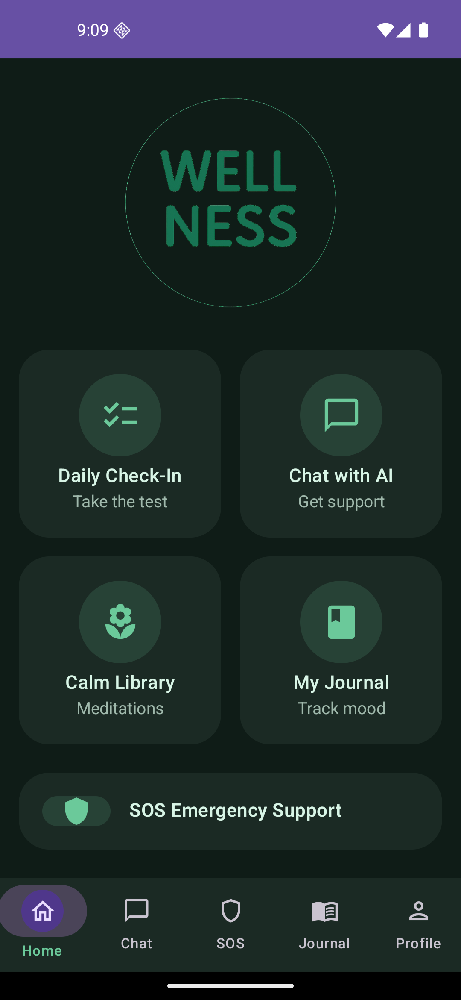
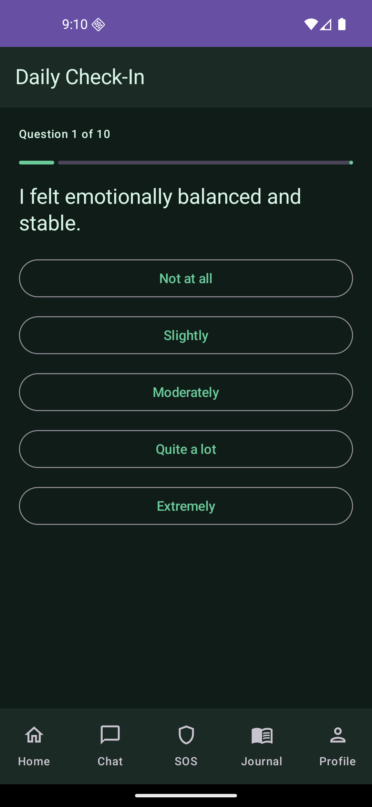
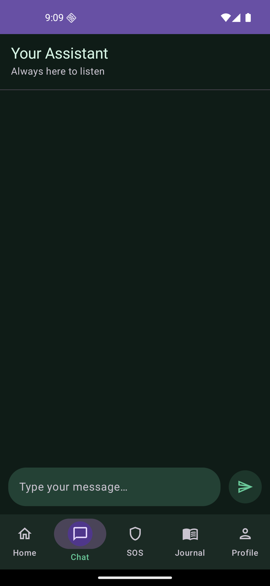
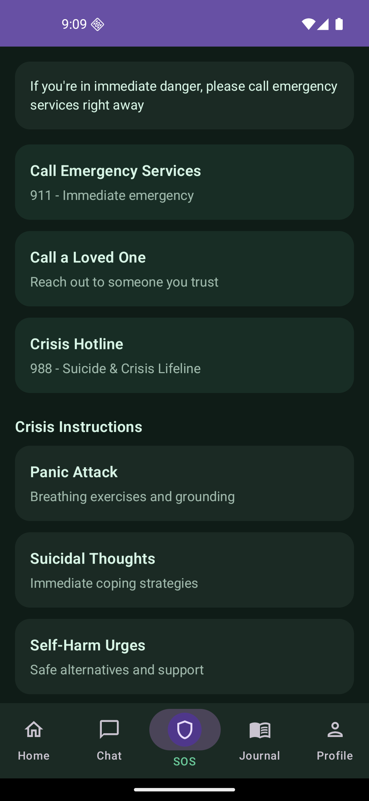
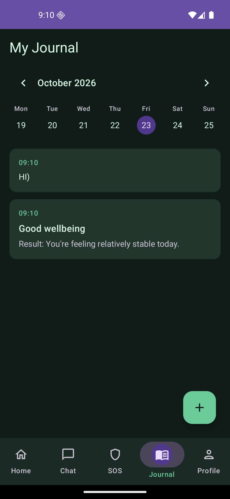
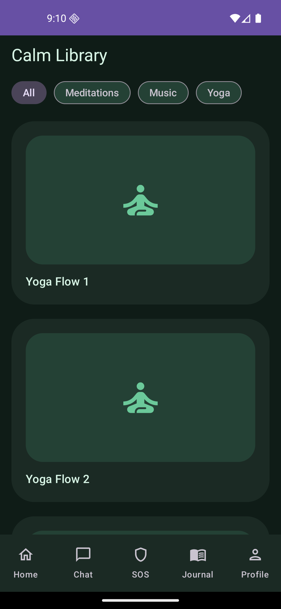
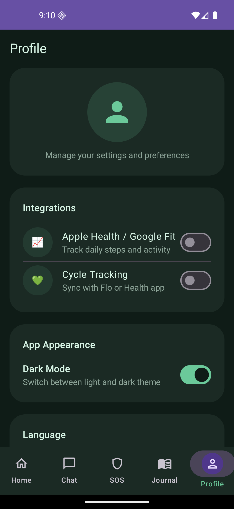

# WellnessApp — AI Mental Health Assistant

WellnessApp is a native Android application engineered for primary psychological support, mood tracking, emotional self-regulation, and crisis stabilization. It combines real-time conversational AI, adaptive self-assessments, emergency grounding protocols, and personal journaling in a privacy-first local environment.

---

## Features & Application Preview

### 1. Home Dashboard

  

The central hub of the application designed with a minimal UI to reduce cognitive load during emotional distress. Provides rapid access to daily check-ins, the AI assistant, emergency SOS protocols, personal journaling, and relaxation resources.

---

### 2. Daily Check-In & Assessment

  

An adaptive survey system that evaluates the user's current psycho-emotional state through standardized psychological questions. Automatically calculates wellness metrics and delivers instant, tailored self-help recommendations based on the score.

---

### 3. AI Chat Assistant

  

Powered by the OpenAI API (ChatGPT) to offer empathetic, real-time conversational support. Features dynamic dialogue handling and interactive responses to assist users in processing complex emotions and learning actionable coping techniques.

---

### 4. SOS Crisis Support

  

A high-priority emergency module built for acute distress situations. Offers distraction-free, step-by-step grounding algorithms and physical exercise instructions for managing panic attacks, severe anxiety, and self-harm urges.

---

### 5. Personal Journal

  

A calendar-integrated digital diary allowing users to record private notes and review past check-in histories over time. Fully synchronized with an encrypted local database to track long-term emotional wellbeing.

---

### 6. Calm Library

  

A structured media repository containing curated breathing exercises, guided meditation templates, and soothing audio tracks to help lower stress levels, manage anxiety, and improve sleep quality.

---

### 7. Settings & Profile

  

Allows users to toggle between Light and Dark themes dynamically, switch application languages (English and Ukrainian), and manage application state securely using Jetpack DataStore Preferences.

---

## Technical Architecture

The project adheres strictly to Google's official Android Architecture Guidelines (Clean Architecture + MVVM) to ensure code maintainability, high performance, and testability.

- **Language:** Kotlin
- **UI Framework:** Jetpack Compose (Declarative UI) with Material Design 3
- **Architecture Pattern:** Model-View-ViewModel (MVVM)
- **Navigation:** Navigation Compose for single-activity transitions
- **Asynchronous & Reactive:** Kotlin Coroutines & Flow (`StateFlow` for UI state binding)
- **Local Storage:** Room Persistence Library (SQLite abstraction layer)
- **Preferences:** Jetpack DataStore Preferences
- **Networking:** Ktor Client for HTTP interactions with the OpenAI API

---
## Setup and Installation

1. Clone the repository:
   git clone https://github.com/ghvinodavardi/WellnessApp.git
   cd WellnessApp

2. Configure OpenAI API Key:
   Create an openai.key file in the app/src/main/assets/ directory and insert your API key:
   sk-proj-YOUR_OPENAI_API_KEY

3. Build and Run:
   Open the project in Android Studio, allow Gradle to sync, and execute the app on an Android device or emulator running Android 8.0 (API level 26) or higher.

## Privacy and Security

Given the sensitive nature of mental health data, WellnessApp operates on a "local-first" storage paradigm:
- All journal entries and survey results are persisted locally via Room.
- Application preferences are stored via DataStore.
- User inputs sent to the OpenAI API are processed strictly for real-time chat interactions without storing personal identifying information externally.

## Disclaimer

WellnessApp is designed for educational and self-help purposes. It serves as a tool for psycho-emotional self-regulation and does not replace professional medical advice, psychiatric evaluation, or clinical therapy.

## Author

**Anna Nikitina** — Android Developer 
[LinkedIn](https://linkedin.com/in/nikitina-anna/) 
[GitHub](https://github.com/ghvinodavardi)
